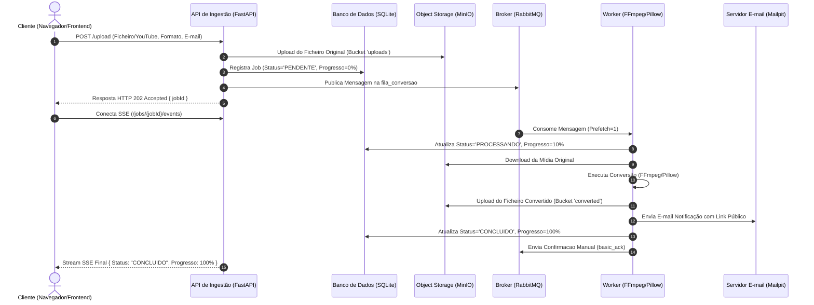

# Conversor de Mídia Assíncrono Distribuído

[](https://www.docker.com/)
[](https://fastapi.tiangolo.com/)
[](https://www.python.org/)
[](https://www.rabbitmq.com/)
[](https://min.io/)
[](LICENSE)

Sistema distribuído e assíncrono para conversão de ficheiros de mídia (vídeo, áudio e imagem) e extração/conversão direta a partir de links do YouTube, com acompanhamento de progresso em tempo real e notificação por e-mail.

---

## Sumário

- [Visão Geral](#-visão-geral)
- [Arquitetura do Sistema](#-arquitetura-do-sistema)
- [Tecnologias Utilizadas](#-tecnologias-utilizadas)
- [Principais Funcionalidades](#-principais-funcionalidades)
- [Pré-requisitos](#-pré-requisitos)
- [Como Executar o Projeto](#-como-executar-o-projeto)
- [Endpoints da API](#-endpoints-da-api)
- [Painéis e Credenciais de Acesso](#-painéis-e-credenciais-de-acesso)
- [Teste de Resiliência e Tolerância a Falhas](#-teste-de-resiliência-e-tolerância-a-falhas)
- [Diagrama de Sequência](#-diagrama-de-sequência)
- [Licença](#-licença)

---

## Visão Geral

O objetivo principal desta aplicação é resolver o problema do bloqueio HTTP durante o processamento pesado de arquivos multimídia. Ao adotar o padrão de **Ingestão Assíncrona (HTTP 202 Accepted)**, a API aceita imediatamente a requisição do utilizador, gera um identificador único (`jobId`) e delega a conversão para uma fila gerida pelo RabbitMQ, onde **Workers concorrentes** realizam o processamento em segundo plano.

---

## Arquitetura do Sistema

A arquitetura é completamente containerizada através do **Docker Compose** e dividida em camadas desacopladas:

```
                  ┌───────────────────────────────┐
                  │    Cliente (Navegador Web)    │
                  └──────────────┬────────────────┘
                                 │ HTTP / SSE
                                 ▼
                    ┌──────────────────────────┐
                    │  Nginx Frontend (:8080)  │
                    └────────────┬─────────────┘
                                 │
                                 ▼
                   ┌────────────────────────────┐
                   │  API de Ingestão (:8000)   │
                   └──────┬──────────────┬──────┘
                          │              │
      ┌───────────────────┘              └──────────────────┐
      ▼                                                     ▼
┌───────────┐                                         ┌───────────┐
│ SQLite DB │ (Shared Volume)                         │ MinIO S3  │
└─────▲─────┘                                         └─────▲─────┘
      │                                                     │
      │              ┌──────────────────────┐               │
      └──────────────┤   RabbitMQ Broker    ├───────────────┘
                     └──────────┬───────────┘
                                │ Fila 'fila_conversao'
                                ▼
                   ┌────────────────────────────┐
                   │  Workers (Python / FFmpeg) │ ──► [Mailpit SMTP]
                   └────────────────────────────┘
```

---

## Tecnologias Utilizadas

- **Linguagem Backend:** Python 3.11+
- **API Framework:** FastAPI (Uvicorn / Starlette)
- **Broker de Mensagens:** RabbitMQ (Com suporte a mensagens duráveis e confirmação manual ACK/NACK)
- **Object Storage:** MinIO (Compatível com AWS S3)
- **Processamento de Mídia:** FFmpeg, Pillow (PIL), `yt-dlp`
- **Comunicação em Tempo Real:** Server-Sent Events (SSE)
- **Servidor Web e Frontend:** Nginx, HTML5, CSS3, JavaScript (Vanilla ES6)
- **Servidor SMTP Simulado:** Mailpit
- **Persistência de Estado:** SQLite em volume compartilhado
- **Orquestração:** Docker & Docker Compose

---

## Principais Funcionalidades

- [x] **Ingestão Assíncrona (HTTP 202):** Aceite imediato de arquivos locais sem travar a interface do utilizador.
- [x] **Integração com o YouTube:** Download e conversão direta de áudio/vídeo a partir de URLs do YouTube via `yt-dlp`.
- [x] **Progresso em Tempo Real:** Transmissão da porcentagem de conversão (0% a 100%) para o frontend via *Server-Sent Events* (SSE).
- [x] **Trabalhadores Escaláveis:** Suporte ao escalamento dinâmico de Workers em paralelo via Docker Compose (`--scale worker=N`).
- [x] **Resiliência e Recuperação:** Mecanismo de *Manual ACK* garante que mensagens não perdidas sejam reprocessadas se um Worker cair.
- [x] **Garantia de Idempotência:** Verificação do estado do pedido antes do reprocessamento para evitar duplicidade de arquivos e e-mails.
- [x] **Notificação Automática:** Disparo de e-mail ao cliente contendo o link direto de download após a conversão.
- [x] **Download Público Seguro:** Ficheiros convertidos armazenados em bucket com política de leitura pública.

---

## Pré-requisitos

Antes de iniciar, certifique-se de que tem as seguintes ferramentas instaladas no seu ambiente:

- [Docker Desktop](https://www.docker.com/products/docker-desktop/) (com suporte a Docker Compose v2)
- Git

---

## 🏁 Como Executar o Projeto

1. **Clone este repositório:**
   ```bash
   git clone https://github.com/Igomes11/Conversor-de-Midia.git
   cd conversor-midia-assincrono
   ```

2. **Inicie os serviços via Docker Compose (com 4 Workers):**
   ```bash
   docker compose up -d --build --scale worker=4
   ```

3. **Verifique o estado dos containers:**
   ```bash
   docker compose ps
   ```

4. **Acompanhe os logs dos Workers em tempo real:**
   ```bash
   docker compose logs -f worker
   ```

---

## Endpoints da API

A API fica disponível em `http://localhost:8000`. As rotas principais são:

| Método | Endpoint | Descrição |
| :--- | :--- | :--- |
| `POST` | `/upload` | Recebe o arquivo/URL, formato de destino e e-mail. Retorna `HTTP 202` com o `jobId`. |
| `GET` | `/jobs/{job_id}` | Retorna o status atual, progresso e URL do arquivo convertido. |
| `GET` | `/jobs/{job_id}/events` | Stream de eventos SSE transmitindo atualizações de progresso em tempo real. |

---

## Painéis e Credenciais de Acesso

| Serviço | URL de Acesso | Utilizador | Senha |
| :--- | :--- | :--- | :--- |
| **Frontend Web** | `http://localhost:8080` | *Acesso Livre* | *Acesso Livre* |
| **Painel MinIO (S3 Console)** | `http://localhost:9001` | `admin` | `password123` |
| **Painel RabbitMQ Management** | `http://localhost:15672` | `guest` | `guest` |
| **Mailpit (Caixa de E-mails)** | `http://localhost:8025` | *Acesso Livre* | *Acesso Livre* |
| **Documentação da API (Swagger)** | `http://localhost:8000/docs` | *Acesso Livre* | *Acesso Livre* |

---

## Teste de Resiliência e Tolerância a Falhas

Para validar a resiliência do sistema (Requisito RNF03):

1. Submeta uma conversão de um arquivo pesado ou link do YouTube através do Frontend.
2. Acompanhe os logs do Worker no terminal (`docker compose logs -f worker`).
3. Interrompa abruptamente o Worker que capturou a mensagem rodando:
   ```bash
   docker stop $(docker ps -q -f name=worker | head -n 1)
   ```
4. Observe que o RabbitMQ detectará a perda da conexão TCP, devolverá a mensagem para a fila (`requeue`) e **outro Worker continuará o processamento**, concluindo a conversão com sucesso sem perder a requisição do utilizador!

---

## Diagrama de Sequência



---

## Licença

Este projeto é disponibilizado sob a licença [MIT](LICENSE).

---

<p align="center">
  Desenvolvido por <strong>Igor Gomes E Hérik Thiury</strong> para a disciplina de Sistemas Distribuídos.
</p>