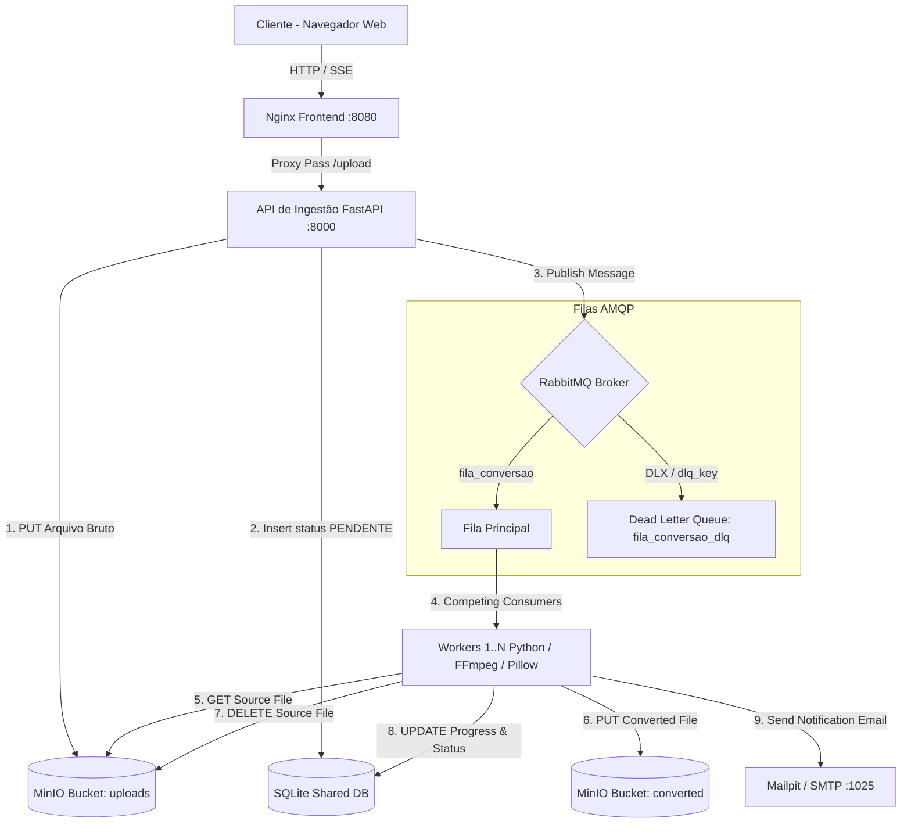
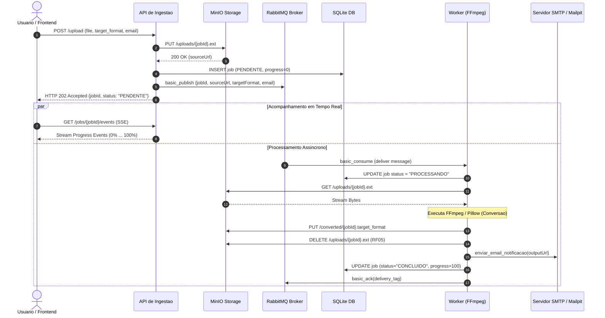

# Conversor de Mídia Assíncrono Distribuído

Sistema distribuído e altamente escalável para conversão assíncrona de arquivos de mídia (vídeo, áudio e imagem). O projeto adota o padrão de **Ingestão Assíncrona (HTTP 202 Accepted)**, acompanhamento em tempo real via **Server-Sent Events (SSE)**, tolerância a falhas com **Dead Letter Queue (DLQ)** e notificação por e-mail.

---

## Sumário

* [Visão Geral](#-visão-geral)
* [Arquitetura do Sistema](#-arquitetura-do-sistema)
* [Diagrama de Sequência](#-diagrama-de-sequência)
* [Tecnologias Utilizadas](#-tecnologias-utilizadas)
* [Principais Funcionalidades](#-principais-funcionalidades)
* [Contrato da Mensagem (Payload)](#-contrato-da-mensagem-payload)
* [Garantias de Entrega e Resiliência](#-garantias-de-entrega-e-resiliência)
* [Pré-requisitos](#-pré-requisitos)
* [Como Executar o Projeto](#-como-executar-o-projeto)
* [Endpoints da API](#-endpoints-da-api)
* [Painéis e Credenciais de Acesso](#-painéis-e-credenciais-de-acesso)
* [Teste de Resiliência e Tolerância a Falhas](#-teste-de-resiliência-e-tolerância-a-falhas)
* [Licença](#-licença)

---

## Visão Geral

O objetivo deste sistema é resolver o problema do bloqueio HTTP no processamento de mídia pesada. Em vez de prender a requisição do usuário aguardando o processamento do FFmpeg/Pillow, a API aceita a solicitação imediatamente, grava o arquivo bruto no **MinIO**, persiste o registro com status `PENDENTE` no **SQLite** e publica a mensagem no **RabbitMQ**.

Os **Workers concorrentes** (executando em background) consomem a fila, convertem o arquivo, persistem o resultado no bucket público do MinIO, removem a mídia de origem, atualizam o progresso no banco de dados e notificam o usuário por e-mail.

---

## Arquitetura do Sistema

A arquitetura é completamente containerizada via **Docker Compose** e desacoplada em microsserviços.

### Diagrama de Componentes (Mermaid)



---

##  Diagrama de Sequência

O diagrama abaixo descreve o ciclo de vida completo de uma requisição de conversão, desde o upload até a notificação por e-mail e acompanhamento via SSE.



---

##  Tecnologias Utilizadas

| Camada / Componente | Tecnologia | Função no Sistema |
| :--- | :--- | :--- |
| **Backend / API** | Python 3.11+ / FastAPI / Uvicorn | Recebe uploads, valida requisições e publica jobs de conversão. |
| **Broker de Mensagens** | RabbitMQ 3.12 | Gerencia filas de mensagens (`durable=True`), confirmações manuais e rota para DLQ. |
| **Object Storage** | MinIO (S3 Compatible) | Armazena uploads temporários (`uploads`) e arquivos convertidos públicos (`converted`). |
| **Processamento de Mídia** | FFmpeg & Pillow (PIL) | Executa conversões de áudio/vídeo e processamento/formatação de imagens. |
| **Tempo Real** | Server-Sent Events (SSE) | Transmite atualizações de progresso (0% a 100%) continuamente ao frontend. |
| **Frontend / Servidor Web** | Nginx / HTML5 / CSS3 / JS Vanilla | Interface gráfica responsiva para upload, consulta e download de mídia. |
| **Servidor de Notificação** | Mailpit / SMTP | Captura e envia e-mails de notificação com links de download pós-conversão. |
| **Persistência de Estado** | SQLite3 | Mantém o histórico, status e progresso dos jobs em volume compartilhado. |
| **Containerização** | Docker & Docker Compose | Isola e orquestra todos os microsserviços e réplicas de workers. |

---

##  Principais Funcionalidades

- [x] **Ingestão Assíncrona (HTTP 202):** Recebimento imediato do arquivo com retorno do `jobId`.
- [x] **Validação no Frontend (Modal de Alerta):** Verificação de compatibilidade que bloqueia tentativas de conversão inválidas (ex: converter foto para áudio/vídeo) antes do envio.
- [x] **Progresso em Tempo Real (SSE):** Transmissão do progresso (0% a 100%) direto para o navegador sem requisições de polling contínuas.
- [x] **Ciclo de Vida Limpo do MinIO (RF05):** Remoção automática do arquivo de origem no bucket `uploads` assim que o processamento é concluído.
- [x] **Trabalhadores Escaláveis:** Configurado nativamente com 4 réplicas paralelas de Workers no Docker Compose (`scale: 4`).
- [x] **Notificação Automática:** Disparo de e-mail ao cliente contendo o link público de download.

---

##  Contrato da Mensagem (Payload)

As mensagens trafegadas na fila `fila_conversao` transportam estritamente metadados (nunca o conteúdo binário do arquivo):

```json
{
  "jobId": "9f2c1a84-3b77-4e5a-9d21-6c0a8f4b1e30",
  "sourceUrl": "http://minio:9000/uploads/9f2c1a84-3b77-4e5a-9d21-6c0a8f4b1e30.mp4",
  "sourceType": "media",
  "sourceFormat": "mp4",
  "targetFormat": "avi",
  "notifyEmail": "usuario@exemplo.com",
  "requestedAt": "2026-10-14T18:22:05Z",
  "attempt": 1
}
```

---

##  Garantias de Entrega e Resiliência

1. **Confirmação Manual (`basic_ack`):** A mensagem só é removida da fila após o sucesso da conversão, upload no MinIO e envio do e-mail.
2. **Garantia de Idempotência:** Antes de converter, o Worker verifica se o `jobId` já possui status `CONCLUIDO` no SQLite. Se sim, ele executa um `basic_ack` instantâneo sem reprocessar.
3. **Política de Retentativas e Dead Letter Queue (DLQ):**
   * Caso um Worker encontre uma falha temporária, a mensagem é re-enfileirada com incremento do contador `attempt` (máximo de 3 tentativas).
   * Se o limite de 3 tentativas for atingido, a mensagem sofre `basic_nack(requeue=False)` e é automaticamente redirecionada para a **Dead Letter Queue (`fila_conversao_dlq`)** através da `dlx_exchange`.

---

##  Como Executar o Projeto

1. **Clone este repositório:**
   ```bash
   git clone https://github.com/Igomes11/Conversor-de-Midia.git
   cd Conversor-de-Midia
   ```

2. **Suba todo o ambiente containerizado com um único comando:**
   ```bash
   docker compose up -d --build
   ```

3. **Verifique o estado dos serviços e das 4 réplicas dos Workers:**
   ```bash
   docker compose ps
   ```

4. **Acompanhe os logs dos Workers em tempo real:**
   ```bash
   docker compose logs -f worker
   ```

---

##  Endpoints da API

A API fica disponível em `http://localhost:8000`:

| Método | Endpoint | Descrição |
| :--- | :--- | :--- |
| `POST` | `/upload` | Recebe arquivo local, formato de destino e e-mail. Retorna `HTTP 202 Accepted` com o `jobId`. |
| `GET` | `/jobs/{job_id}` | Retorna o status atual, progresso (0-100%) e URL de download. |
| `GET` | `/jobs/{job_id}/events` | Stream de eventos Server-Sent Events (SSE) para atualização em tempo real. |

---

##  Painéis e Credenciais de Acesso

| Serviço | URL de Acesso | Credenciais |
| :--- | :--- | :--- |
| **Frontend Web** | `http://localhost:8080` | *Acesso Livre* |
| **Painel RabbitMQ** | `http://localhost:15672` | Usuário: `guest` \| Senha: `guest` |
| **Console MinIO (S3)** | `http://localhost:9001` | Usuário: `admin` \| Senha: `password123` |
| **Mailpit (Caixa de E-mails)** | `http://localhost:8025` | *Acesso Livre* |
| **Swagger API Docs** | `http://localhost:8000/docs` | *Acesso Livre* |

---

##  Teste de Resiliência e Tolerância a Falhas

Para demonstrar a resiliência a falhas ao professor:

1. Acesse `http://localhost:8080` e submita um arquivo de vídeo para conversão.
2. Acompanhe os logs dos Workers no terminal (`docker compose logs -f worker`).
3. Assim que um Worker capturar a mensagem, derrube a instância simulando um crash:
   ```bash
   docker stop $(docker ps -q -f name=worker | head -n 1)
   ```
4. Observe que o RabbitMQ detectará a perda da conexão, devolverá a mensagem para a fila (`requeue`) e **outra das réplicas ativas continuará o processamento**, concluindo a conversão normalmente!

---

## Licença

Este projeto foi desenvolvido pelos alunos Igor Gomes e Hérik Thiury para a disciplina de Sistemas Distribuídos no IFPE Campus Jaboatão dos Guararapes.